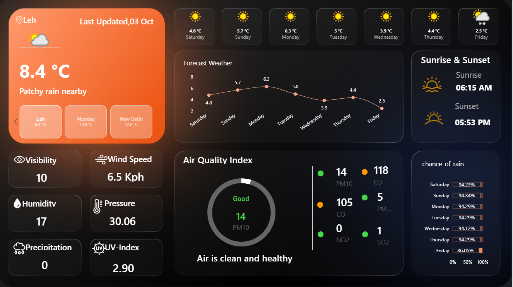

# Weather_Dashboard

A centralized, interactive Power BI dashboard for monitoring weather conditions, identifying seasonal trends, and comparing climate patterns across regions and time periods.

---

## 🎯 Short Description & Purpose

The purpose of this project is to turn raw weather data into a clear, decision-ready visual story. This dashboard helps users analyze temperature fluctuations, rainfall, humidity, and seasonal weather patterns in a single view, enabling quick comparisons between locations and time periods.

---

## 🛠️ Tech Stack

* **Business Intelligence:** Power BI Desktop
* **Data Transformation & Modeling:** Power Query, DAX (Data Analysis Expressions)
* **Data Source Architecture:** Historical climate/weather dataset (structured weather records)
* **Visualization Layer:** KPI cards, line charts, bar charts, matrix, slicers

---

## 📂 Data Source

The dashboard is designed to work with structured weather records containing:

* **Time Dimensions:** Date, Month, Year, Season
* **Climate Metrics:** Temperature, Humidity, Precipitation, Wind Speed, Pressure
* **Location Details:** Region, City, Station, Country
* **Comparative Fields:** Year-over-Year and seasonal variations

---

## ✨ Features & Highlights

* **Dynamic Weather KPI Summary:** Quick overview of temperature, precipitation, humidity, and climate extremes.
* **Time-Series Trend Analysis:** Visualize monthly or seasonal temperature and rainfall changes.
* **Regional Comparison:** Compare weather patterns across cities or regions with side-by-side visuals.
* **Interactive Filtering:** Use slicers to drill down by year, month, region, or season.
* **Conditional Formatting:** Highlight unusual patterns and anomalies in a clean, readable layout.

---

## 📊 Business Problems & Goal of Dashboard

### Business Problems Addressed:

* Difficulty in tracking weather variability across time and geography.
* Lack of visibility into seasonal climate behavior and anomaly periods.
* Limited capability to compare local and regional weather trends in one place.
* Fragmented climate information spread across raw data sources and reports.

### Strategic Goal:

To build a simple, interactive dashboard that transforms weather data into actionable insights for planning, analysis, and operational decision-making.

---

## 🚶 Walkthrough by Visuals

### 1. KPI Summary (Top Ribbon)

* Displays key metrics such as average temperature, rainfall, humidity, and other climate indicators.
* Helps users quickly understand current conditions and trends.

### 2. Temperature Trend Analysis (Line Chart)

* Examines temperature changes over time to identify seasonal peaks, drops, and long-term movement.

### 3. Rainfall & Humidity Insights (Bar/Area Charts)

* Highlights monthly or regional precipitation and moisture patterns.
* Useful for identifying dry and wet periods.

### 4. Regional Comparison (Clustered Bar Charts)

* Compares climate behavior between regions, cities, or stations.

### 5. Climate Summary Matrix (Data Grid)

* Provides a structured view of weather metrics across multiple categories and time periods.

---

## 💡 Business Impact & Insights

* **Seasonal Awareness:** Understand which months experience peak temperatures or heavy rainfall.
* **Regional Monitoring:** Spot areas with unusual climate patterns or elevated variability.
* **Operational Planning:** Support better planning for agriculture, logistics, infrastructure, and daily forecasting needs.
* **Decision Support:** Enable faster analysis without needing to manually interpret raw weather data.

---

## 📸 Screenshots

---

## 📁 Repository Contents

* `Weather_Dashboard.pbix` — Power BI report file
* `Dashboard.PNG.png` — dashboard preview image
* `README.md` — project documentation

---

## 🧰 How to Use

1. Download or clone this repository.
2. Open `Weather_Dashboard.pbix` in Microsoft Power BI Desktop.
3. Explore the interactive visuals, filters, and KPI cards.
4. Refresh the dataset if needed and adapt the report to your own weather data source.

---

## ⚠️ Notes

This project is intended as a sample dashboard and may require data source updates depending on the environment in which it is opened. If you are using your own weather dataset, you may need to map fields to the report visuals accordingly.

---

## 📜 License

No explicit license file is included in this repository. Please treat this project as a personal or educational sample unless otherwise specified by the repository owner.

---

## 📧 Contact

For questions, suggestions, or improvements, please reach out through the repository owner or project maintainer.
